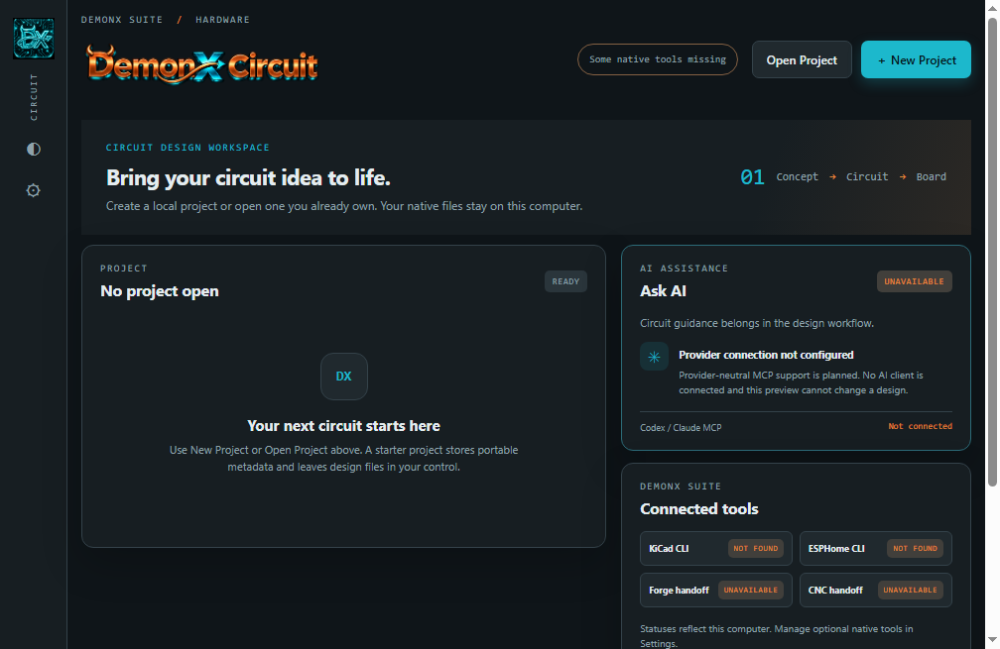
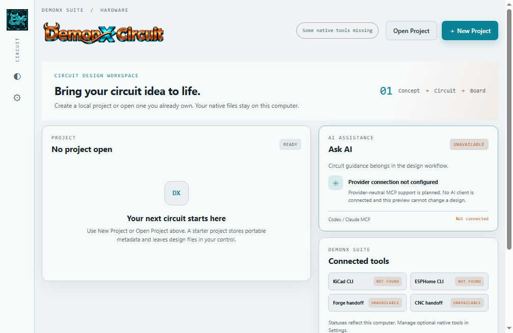

# Checkpoint 3 — packaged Windows acceptance and official branding

Tested: 2026-10-24 16:35 UTC | Branch: `codex/demonx-circuit-foundation` | Build commit: `0f995543fe6f240ec8797e369f1b326688420448` | Workflow: [Windows preview run 40112188110](https://github.com/pricklyguy/DemonX-Circuit/actions/runs/40112188110) (**PASS**)
Runtime: Windows 2022, Node.js 24.19.0, Electron 45.0.0, DemonX Circuit 0.4.1

## Windows package and acceptance results

| Area | Result | Evidence |
|---|---|---|
| Extracted portable ZIP launches | **PASS** | Windows 2022 extracted the uploaded ZIP and launched `DemonX Circuit.exe` from `resources/app`. |
| Official Circuit wordmark | **PASS** | Packaged renderer loaded `./assets/DemonX Circuit.png` at its original 2172×724 dimensions with the expected alt text. The PNG is RGBA and copied byte-for-byte from the repository artwork. |
| Circuit DX icon and packaged window icons | **PASS** | Renderer loaded the supplied 256×256 Circuit board icon. Packaged app resources include the supplied Windows `.ico` and Linux 512×512 PNG. `BrowserWindow` selects ICO on Windows and PNG on Linux. |
| New Project | **PASS** | Real mouse click created `project.json` in an isolated temporary project root. |
| Open Project | **PASS** | Real mouse click reopened the created project and restored its project ID. |
| Recent Projects | **PASS** | Real mouse click reopened the project from the recent list; the list persisted through app restart. The test scrolls lower dashboard targets into view and verifies each click lands on its intended control. |
| Settings and theme | **PASS** | Rail and Settings theme controls changed themes; the selected theme persisted after closing and relaunching the packaged executable. |
| Native-tool availability | **PASS** | The runner reported KiCad CLI/editor and ESPHome CLI absent, and the dashboard showed `NOT FOUND`. |
| Missing-tool responses | **PASS** | KiCad editor, ERC/DRC, manufacturing actions, and ESPHome CLI validation report `NOT TESTED` with actionable missing-tool explanations. |
| ESPHome preview generation | **PASS** | The packaged fixture generated YAML containing ESP32-S3, GPIO8 SDA, and GPIO10 relay mapping. |
| Unhandled renderer/preload exceptions | **PASS** | Packaged acceptance reported `unhandled: []`. |
| KiCad editor / native ERC/DRC / Gerber, Excellon, STEP from this package | **NOT TESTED** | KiCad was not installed on the hosted Windows runner. The separate native KiCad fixture results remain in `CHECKPOINT-3-RESULTS.md`. |
| ESPHome CLI compatibility validation | **NOT TESTED** | ESPHome CLI was not installed on the hosted Windows runner; this acceptance covered generation and the explicit not-installed status only. |
| Owner's Windows computer | **NOT TESTED** | Packaged acceptance was performed on GitHub-hosted Windows 2022. |

## Artifacts

- Runnable portable Windows ZIP: [download artifact 12567246177](https://github.com/pricklyguy/DemonX-Circuit/actions/runs/40112188110/artifacts/12567246177) (275,587,151 bytes; expires 2026-11-23). Extract and launch `DemonX Circuit.exe`. KiCad 10.0.7 and ESPHome CLI remain separate prerequisites for their native actions.
- Machine-readable click report and screenshots: [download acceptance artifact 12567201405](https://github.com/pricklyguy/DemonX-Circuit/actions/runs/40112188110/artifacts/12567201405).

The images below are static still captures of the packaged Electron application's actual renderer. The ZIP is the interactive desktop build; no interactive browser-only demo is provided.

## Packaged Electron screenshots

## Scope

The existing project dashboard and workflows were preserved; no EDA or manufacturing feature work was added. The Circuit wordmark and DX art are original supplied assets; dark/light interface colors provide contrast without recoloring or cropping them. Other Suite artwork remains under the repository `assets/` folder and is not loaded by the UI. AI/MCP and Forge/CNC remain visibly unavailable. For development on Windows, use Node.js 24.x and run `npm ci` followed by `npm start` from the repository root.
